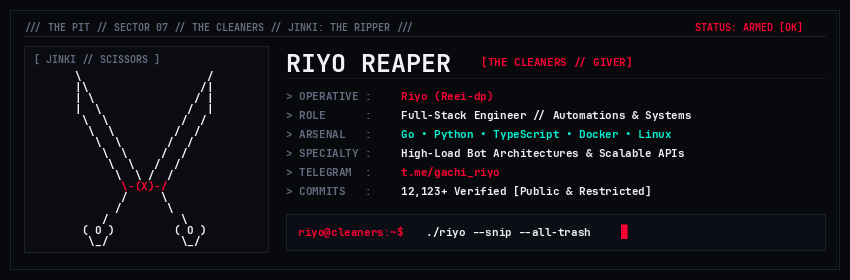

  
  

---

- **LANGUAGES** : `Go` • `Python` • `TypeScript` • `JavaScript` • `C/C++` • `Shell`
- **BACKEND & APIS** : `FastAPI` • `Gin` • `AsyncIO` • `REST` • `WebSocket`
- **FRONTEND & UI** : `React` • `Next.js` • `HTML5 / CSS3` • `Tailwind`
- **SYSTEMS & INFRA** : `Docker` • `Linux Kernel` • `PostgreSQL` • `Redis` • `Git`
- **AUTOMATION** : `Telegram Bot Architecture` • `Telethon / Pyrogram` • `Reverse Engineering`

---

