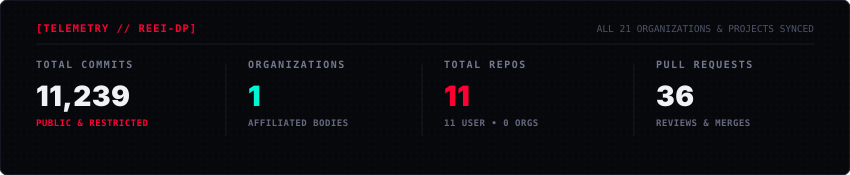

<div align="center">

<!-- ANIMATED RIYO REAPER BANNER -->


<p align="center">
  <code><b>✂️ SECTOR: THE PIT</b></code> •
  <code><b>AGENT: RIYO [Reei-dp]</b></code> •
  <code><b>JINKI: THE RIPPER</b></code> •
  <code><b>FOCUS: FULL-STACK &amp; AUTOMATION</b></code>
</p>

```text
 ✂ ══════════════════════════════════════════════════════════════════════ ✂
  "Snip away the bloat. Keep the code fast, modular, and reliable."
 ✂ ══════════════════════════════════════════════════════════════════════ ✂
```

</div>

---

### 🎀 About Me

Full-stack engineer and automation developer focused on building modern web applications, scalable backend services, robust bot infrastructure, and clean APIs.

* 📍 **Focus**: Full-Stack Web, Microservices &amp; Bots
* 🛠️ **Main Stack**: TypeScript, Go, Python, Docker
* ⚡ **Interests**: High-load architectures, responsive UIs, asynchronous pipelines &amp; API design

---

### 🗡️ Tech Stack &amp; Tools

<div align="center">

#### `// FRONTEND & CLIENT`
<p>
  
  
  
  
  
</p>

#### `// BACKEND & APIS`
<p>
  
  
  
  
  
</p>

#### `// BOT INFRASTRUCTURE & DEVOPS`
<p>
  
  
  
  
</p>

</div>

---

### 📊 Activity &amp; Overview

<div align="center">

<!-- LIVE VERIFIED METRICS INCLUDING PRIVATE CONTRIBUTIONS -->


<br><br>

<!-- COMPACT TOP LANGUAGES -->


</div>

---

### 📡 Contact &amp; Channels

```text
 ┌──[ TRANSMISSION ]──────────────────────────────────────────────────┐
 │  ✂ EMAIL    : gachi.riyo@gmail.com                                 │
 │  ✂ GITHUB   : github.com/Reei-dp                                   │
 │  ✂ TELEGRAM : @your_telegram                                       │
 └────────────────────────────────────────────────────────────────────┘
```

<div align="center">
  <sub><code>[ ✂ CLEANED &amp; MAINTAINED BY RIYO // REEI-DP ]</code></sub>
</div>
